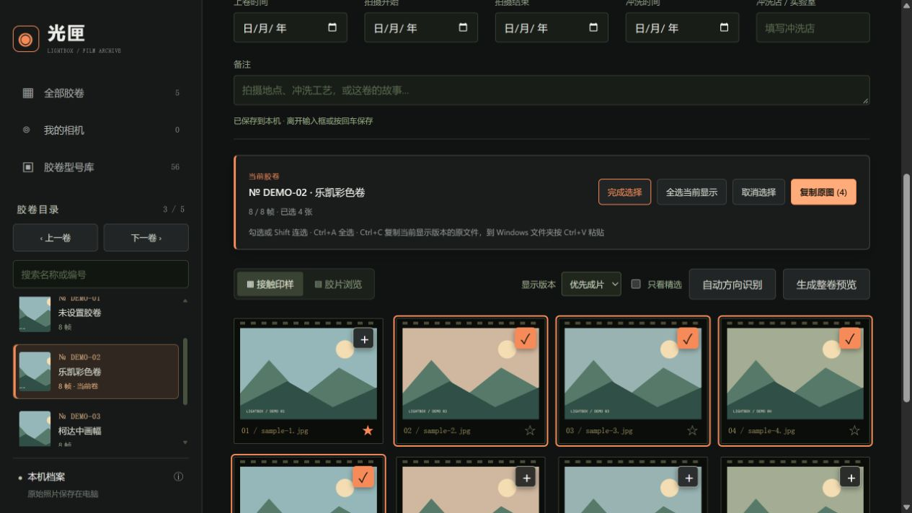
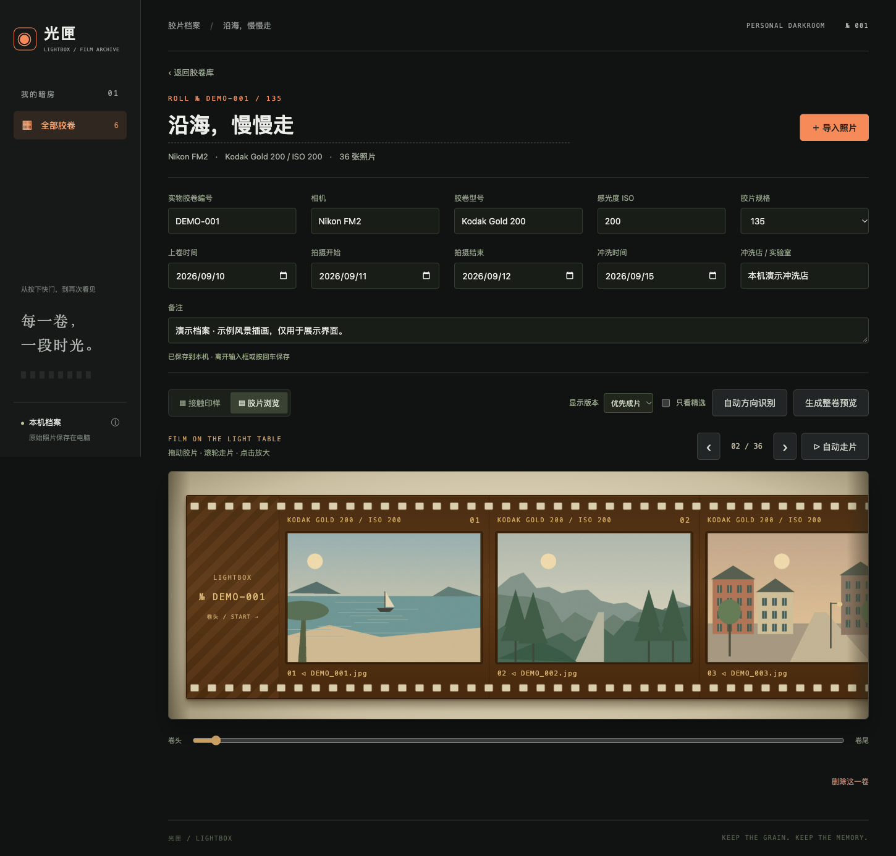

# 光匣 · FilmPhotoManager

按胶卷整理冲洗后的电子照片，在本机浏览、归档和打印整卷接触印样。当前版本 **1.11.0**。

## 界面与预览

以下为当前版本的真实界面截图，使用虚构胶卷档案与原创风景插画演示，不包含个人照片或本机文件路径。点击图片可查看大图。

### 胶卷库

按卷查看封面、实物编号、相机、胶卷型号和拍摄跨度。支持名称与器材搜索，并组合筛选相机、胶卷型号、规格、年份；可按日期、编号、名称和照片数量排序。


### 在页面内直接编辑档案

名称、相机、胶卷型号、编号和日期都能直接修改，离开输入框自动保存。下方以接触印样查看整卷照片。照片区保留当前胶卷信息，支持勾选多张、Shift 连选、Ctrl+A 全选，以及 Windows 原图文件复制与文件夹粘贴。




### 连续胶片条

采用确认后的平视效果：固定暗盒，向右拉出胶片，向左回卷，新帧从出片口出现，先拉出的帧留在外端。生成的透明暗盒素材与胶片宽度共用一套坐标；135 使用 35mm 片宽、36×24mm 窗口和连续齿孔，120 使用独立卷轴与无齿孔胶片。支持鼠标拖动、触屏横滑、滚轮、键盘、逐帧按钮、定位滑杆与自动走片；缩放后保留展开位置。鼠标拖动跟手，松手后惯性滑行并渐停；滚轮、逐帧和滑杆共用可打断的缓动，触屏保留浏览器原生惯性。

乐凯 C200 使用专属生成素材，其他已知型号通过统一暗盒和品牌配色、型号标签联动；未设置或未知型号使用无标识黑色暗盒。素材随软件保存，可离线显示。见 [平视素材与生成提示词](public/assets/film-reel/GENERATION.md)。



### 可打印的整卷预览

下面两张图片由软件直接导出，均包含演示胶卷的全部 **36 帧**，保留完整画面。点击查看原始尺寸；打印时选择对应比例或保留白边。

| 3:2 横向 · 常规照片打印 | 16:9 横向 · 宽幅预览 |
| --- | --- |
|  |  |
| 3600 × 2400 像素 | 3840 × 2160 像素 |

## 快速开始

支持 **Windows 10 / 11、macOS 和 Linux**，需要 **Node.js 20.9 或更新版本**。首次运行执行 `npm ci` 安装图像引擎、BMP 解码器及离线中英文 OCR 模型；TIFF / BMP 的浏览预览、旋转、文件夹导入均在本机完成。Windows 使用系统人脸检测和 Tesseract 离线 OCR 比较四个方向；macOS 使用 Vision 自动识别人脸和文字方向。Linux 提供手动方向核对。各平台均支持批量应用与撤销。

```bash
git clone https://github.com/zhbuaa0/FilmPhotoManager.git
cd FilmPhotoManager
npm ci
npm start
```

浏览器打开 [http://127.0.0.1:4317](http://127.0.0.1:4317)。Windows 可双击 **打开光匣.cmd**，macOS 双击 **打开光匣.command**，首次会安装依赖并自动打开浏览器。请保留启动窗口，停止时按 Ctrl+C。

## 已实现

- **胶卷型号库**：56 款常见型号，覆盖 12 个品牌，按品牌、彩色 / 黑白 / 反转 / 特殊色彩、规格与 ISO / EI 筛选，支持中文别名和包装图片选择。新建胶卷、详情页均可选用；更换型号默认带入标注的感光度与兼容规格，主档案不再单独显示 ISO、规格输入框；同一型号已有的曝光记录保留，选型面板可取消带入以保留自定义曝光。保留自定义型号，不自动改写历史档案。图片首次从列明来源加载后缓存在本机。
- **相机预览图**：μ-II 35mm 定焦机身、Kiss III 同款 EOS 300 机身及 EF 50mm f/1.8 STM 镜头参考照片，附作者、来源和授权说明，随应用离线显示；可点图放大、手动选择参考图或上传自己的相机照片（JPG / PNG / WebP，8 MB 以内）。个人照片保存在本机，支持随档案备份。图片说明见 [署名与授权](public/assets/cameras/ATTRIBUTION.md)。
- **我的相机**：登记机身、镜头、规格、编号、购入日期、使用状态和资料来源；新建胶卷与详情页可下拉选择，改名同步已关联胶卷，移除登记保留历史文字。提供可选的 Olympus μ-II 与 Canon EOS Kiss III + EF 50mm f/1.8 STM 官方资料模板，默认不会把模板当成个人器材。
- **按卷归档**：记录名称、实物编号、相机、胶卷型号、ISO、规格、上卷时间、拍摄跨度、冲洗时间、冲洗店和备注。直接在胶卷页编辑并自动保存；ISO 和规格随型号带入。
- **导入扫描照片**：支持 TIFF、BMP、JPG、PNG、WebP 和 GIF，单张不超过 80 MB；批量文件夹导入、引用原目录或复制原图、重复文件跳过。
- **重复副本识别**：每卷导入前进行完整文件 SHA-256 校验，跳过内容完全一致的副本，保留非副本名称和扫描原片；不同内容的成片版本仍保留，源目录不改动。
- **扫描原片与成片关联**：使用 JPEG 的 XMP 原文件名匹配 TIFF / BMP，支持带日期前缀的原片重命名和跨后期目录关联，THM 辅助文件自动忽略；同一帧支持多个版本。
- **卷间快速切换**：详情页左侧提供带封面的胶卷目录、搜索、当前卷高亮与上一卷 / 下一卷；窄窗口提供固定的跳转栏。
- **照片浏览**：接触印样网格、放大查看、星标精选、拖动帧序、手动旋转及原图下载。
- **连续胶片条**：带连续齿孔、卷头卷尾和帧号，支持拖动、滚轮、触屏、键盘、定位滑杆与自动走片。
- **本机方向识别**：按人脸和文字朝向给出旋转建议，提供前后对照、待确认筛选、批量应用、手动方向保护和撤销；照片不上传，原文件不改写。Windows 10 / 11 通过系统 Windows PowerShell 调用 FaceDetector，并用带置信度的离线中英文 OCR 验证文字方向；无需 Python，系统人脸检测不可用时明确降级为文字识别。Apple 芯片 Mac 使用随附引擎，其他 Mac 架构首次使用需 Apple 命令行开发工具编译。
- **打印预览**：整卷 PNG 接触印样，横向 3:2（3600 × 2400）、横向 16:9（3840 × 2160）及按内容自动适配，照片完整显示。

完整操作、导入和备份说明见 [使用说明](使用说明.md)。

## Windows 胶片目录

- 支持中文路径，例如 `E:\胶片档案`，也可粘贴资源管理器复制的带引号路径。
- 按 `2026.04.25_0013_00939` 一类目录拆卷，编号为 `0013`，保留前导零和二级编号。目录日期保存到备注，拍摄与冲洗日期仍留待确认。
- 如有 `film_index.csv`（日期、一级ID、二级ID、备注），按一级编号读取备注；索引与目录日期不同会分别保留，不改写 CSV。
- 同时存在逐卷目录和根目录拼图时，优先逐卷导入并提示散图未导入。默认跳过“汇总文件夹”，可勾选包含，避免重复归档。
- 分散在“后期”目录中的 JPEG，只有 XMP 原文件名唯一匹配时才关联回原卷，不按序号猜测。

## 保存与备份

首次启动自动创建 `data/`，其中保存档案、照片副本、独立缩略图和导出预览。该目录被 Git 忽略，仓库不包含个人胶卷档案或照片。

- 备份前先停止软件，再复制整个 `data/`。
- 使用“引用原目录”时，还需备份源胶片文件夹并保持引用路径可用。
- 软件只在 `127.0.0.1` 提供本机服务，面向个人使用。
- 旧版本的 SQLite 档案与当前 JSON 档案格式不同，目前没有自动迁移工具；旧档案请保留备份。

## 开发与检查

```bash
npm test
```

检查覆盖型号检索、规格和 ISO 选择、图片下载去重与离线缓存、档案保存恢复、文件夹导入、XMP 关联、源文件保护、四方向实际 OCR、EXIF 朝向、证据冲突与撤销、打印布局。图像检查使用跨平台引擎，可在 Windows 上完整运行。GitHub Actions 同时验证 Windows、macOS 和 Linux。

```text
server.mjs              本机 HTTP 服务和档案保存
image-preview.mjs       跨平台 TIFF / BMP 预览与旋转
launcher.mjs            自动打开浏览器并复用本机服务
打开光匣.cmd             Windows 启动入口
local-import.mjs        文件夹检查、照片关联和导入
orientation.mjs         方向判断、应用与撤销
public/                 页面、样式、交互和打印排版
orientation-text.mjs    离线中英文 OCR 与文字置信度
orientation-windows.mjs Windows 人脸适配和证据判断
native/                 Windows FaceDetector 脚本、macOS Vision 引擎
tests/                  自动检查
使用说明.md             操作与备份说明
打开光匣.command         Mac 启动入口
```

本次更新以当前光匣软件替换旧的 Flask / React 实现，原版本仍保留在 Git 提交历史中。
